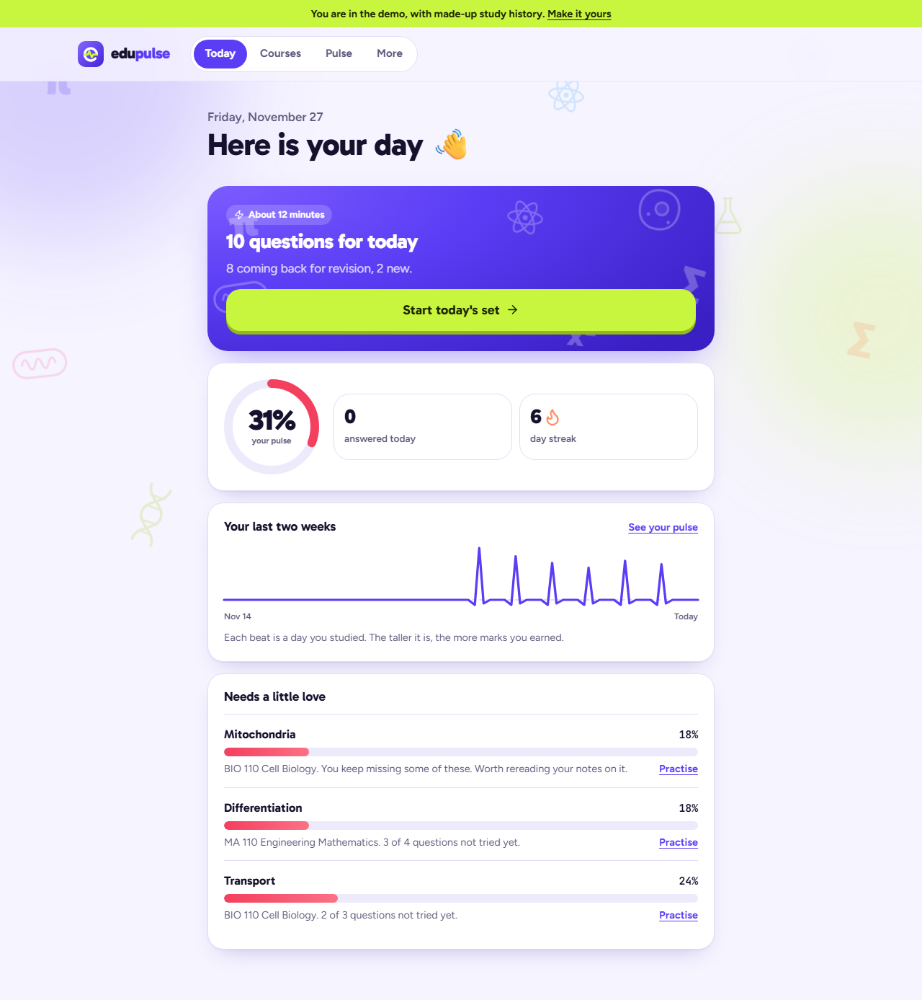
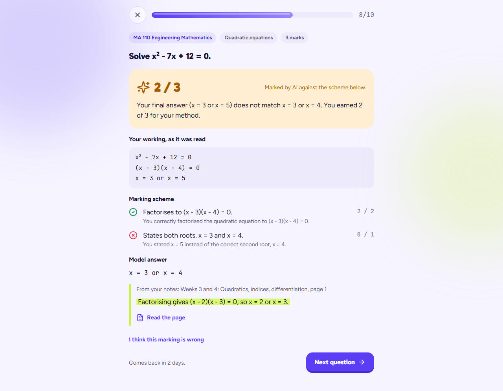
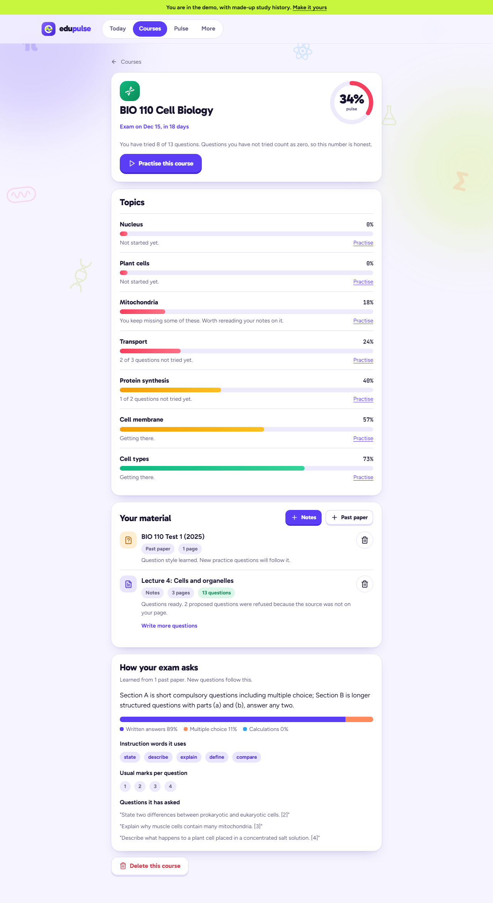

# EduPulse

[](https://github.com/BlessingsBlessedChongo/EduPulse/actions/workflows/ci.yml)

**Know what to study today.** EduPulse turns a learner's own notes into daily
practice questions, written in the style of their own lecturer's past papers.
It marks the answers, including handwritten maths from a photo, and brings each
question back just before it would be forgotten.

Built with C# and ASP.NET Core 9, PostgreSQL, React and TypeScript.

**Try it live: <https://edupulse-phf2.onrender.com>** and press *Try the demo*. It runs on free hosting, so the first visit after a quiet spell can take a minute to wake.



> **The idea in one line:** the AI proposes, and rules decide. A question is
> kept only if its source sentence really is on the learner's page, and a maths
> answer is judged by calculation, never by a model's opinion.

## The problem

Most students revise by rereading their notes, which is one of the weakest ways
to learn. The two methods with the strongest evidence are testing yourself and
spacing revision over days. Almost nobody does them, because writing your own
questions and planning a schedule is real work.

EduPulse does that work:

| The learner | EduPulse |
|---|---|
| Adds a PDF, a photo of handwritten notes, or pasted text | Reads it and writes practice questions from those pages only |
| Adds a past paper | Learns how that exam words and weights its questions, per course |
| Answers a short set each day, typed or as a photo of working | Marks it against a marking scheme and shows the reasons |
| Does nothing else | Brings each question back at a growing gap, and shows an honest score per topic |

## Why the marks can be trusted

A study tool that asks a language model and repeats whatever comes back will
invent questions and mis-mark answers. EduPulse puts a rule between the model
and the learner at every step.

| Risk | What EduPulse does about it | Where |
|---|---|---|
| The model writes a question about something not in the notes | Each question must quote the sentence it rests on. The quote is searched for on the learner's page; if it is not there, the question is refused. | `Words.AppearsOn`, `QuestionMaker.Check` |
| The model sets a sum and gets its own answer wrong | A second, separate working must reach the same final answer, compared by calculation. | `QuestionMaker.ConfirmMaths` |
| The model marks a right maths answer wrong, or a wrong one right | The final answer is compared by a maths engine: `x = 3`, `6/2` and `3.0` are the same; `2(x+1)` equals `2x + 2`. No model is asked. | `MathsEngine` |
| The model is generous when reading handwriting | A wrong final answer can never earn full marks, whatever the model awarded for the steps. | `Marker.Maths` |
| The models are down or out of allowance | Questions fall back to fill-in-the-blank made by rules; written answers are marked by matching words to the scheme, and say so. | `RuleQuestions`, `Marker.Written` |
| The learner thinks a mark is wrong | They say why, and may add a clearer photo. A second examiner looks again and answers: the mark goes up, or it stands and they are told why. Learners cannot set their own marks, each answer is reviewed once, and calculation cannot be argued with. | `Marker.ReviewAsync` |



In the picture above the learner factorised correctly and slipped on the last
line. The model read the handwriting and awarded the method marks; the engine
found that the final answer does not match.

## What has been measured

From [docs/MEASURED.md](docs/MEASURED.md), produced by `dotnet run --project server/EduPulse.Evals`:

| Check | Result |
|---|---|
| Maths final answers judged by calculation | 72 of 72 pairs correct; 0 wrong answers accepted |
| "Is this quote really on the page?" | 30 of 30 correct; 0 quotes from elsewhere accepted |
| Written answers marked by AI, against the author's own marks | 21 of 21 the same mark (3 more got no answer from the model and are not counted) |
| The same answers marked by rules alone, with no AI | 17 of 24 the same mark, 22 of 24 within one |

These are small sets written and labelled by the author, and they show how the
checks behave. How accurately handwriting is read has only been tried by hand,
on a few clear samples. The file says what has not been measured.

## Try it

You need the .NET 9 SDK, Node 22 and PostgreSQL.

```bash
git clone https://github.com/BlessingsBlessedChongo/EduPulse.git
cd EduPulse

scripts/dev-db.sh start            # a private PostgreSQL in .devdb, on port 54329
cp .env.example .env               # then set EDUPULSE_SECRET; AI keys are optional

(cd web && npm install && npm run build)
dotnet run --project server/EduPulse.Api --urls http://localhost:5199
```

Open <http://localhost:5199> and press **Try the demo**. It opens a private
sample learner with two courses, notes, a learned exam style and a week of
study history, so every screen has something on it. No AI key is needed for the
demo.

With no AI keys at all, EduPulse still works by rules. Add a free Gemini key
(reads photos and PDFs) or Groq key (text only) to `.env` for full questions
and marking.

## How it works

```
 Notes (PDF, photo, text)                       Past paper
          │                                          │
          ▼                                          ▼
   DocumentReader ──► pages of text           StyleLearner ──► question style
          │              (only text is kept)    (instruction words, marks, mix)
          ▼                                          │
    QuestionMaker ◄──────────────────────────────────┘
          │   model proposes
          ▼
   rule checks: quote on the page? well formed? maths confirmed twice?
          │   refused questions are counted and shown to the learner
          ▼
      Questions ──► Today's set ──► Answer (typed or photo)
                                         │
                                         ▼
                                      Marker
                     exact │ maths engine │ model against the scheme │ word rules
                                         │
                                         ▼
                              Scheduler (when it comes back)
                                         │
                                         ▼
                              Pulse (how strong each topic is today)
```

| Part | What it does |
|---|---|
| **Reading** | A PDF with real text is read locally (PdfPig). A scan or a photo of handwriting is read by a model that can see. Only the text is kept, never the file. |
| **Question style** | Marks, instruction words and the mix of question kinds are counted by rules; a model adds the layout and picks model questions. A second paper refines the style. |
| **Marking** | Four methods, used in order of trust: exact match, the maths engine (AngouriMath), a model held to the scheme point by point, and word matching. |
| **Schedule** | Right answers come back after 1, 3, 7, 15, 33 days, up to 60. A wrong answer returns tomorrow. |
| **Pulse** | For each topic, the share of its questions the learner would likely get right today. Untried questions count as zero and old results fade, so the number cannot flatter. It is private; nothing is ranked. |

For a tour of the code in the order a document travels through it, with the
questions an interviewer is likely to ask, read
[docs/HOW_IT_WORKS.md](docs/HOW_IT_WORKS.md).



## Security and privacy

- Passwords are stored only as salted PBKDF2 hashes (210,000 rounds).
- Sign-in is a signed token in a cookie that the page's scripts cannot read. Changing the password ends every older sign-in.
- Every query is scoped to the signed-in learner; one learner cannot see or touch another's work (tested).
- A request that changes anything is refused if it comes from another website.
- Uploaded files are checked by their first bytes, read once, and then discarded. Only the text is stored.
- Sign-in, uploads and answers are rate limited, and photo marking is capped per learner per day.
- A strict content security policy: scripts, styles and fonts load from this site only.
- Deleting an account removes its courses, notes, questions and history.

## API

The OpenAPI description is served at `/openapi/v1.json`.

| Method | Path | What it does |
|---|---|---|
| `POST` | `/api/auth/register`, `/login`, `/demo`, `/logout` | Accounts and the demo |
| `GET` `POST` | `/api/courses` | List and add courses |
| `GET` `PATCH` `DELETE` | `/api/courses/{id}` | One course: pulse, topics, material, learned style |
| `POST` | `/api/courses/{id}/documents` | Add notes or a past paper (file or text) |
| `POST` | `/api/documents/{id}/more` | Write another round of questions |
| `GET` | `/api/documents/{id}/pages/{n}` | The page a question came from |
| `GET` | `/api/today` | Today's set: what is due, plus a few new questions |
| `GET` | `/api/courses/{id}/practice` | Free practice, weakest first |
| `POST` | `/api/questions/{id}/answer` | Mark an answer (typed, or a photo) |
| `POST` | `/api/attempts/{id}/dispute` | Challenge a mark and have it reviewed |
| `GET` | `/api/pulse` | Strength by course and topic, and the last 14 days |
| `GET` | `/api/measured` | This server's own counts: questions kept and refused, model speed |

## Tests

```bash
scripts/dev-db.sh start
dotnet test server/EduPulse.Tests
```

84 tests. The service tests run the whole application against a real
PostgreSQL with a stand-in for the models, so they are fast, free and the same
every run. They cover sign-in, isolation between learners, the question checks,
every marking path, challenges to a mark, the schedule, the pulse and the demo. The same tests run on
every push ([workflow](.github/workflows/ci.yml)), followed by a Docker build.

## Deploying

One Docker image holds the service with the web app inside it. `render.yaml`
describes a free Render web service; the database is a free Neon PostgreSQL.

| Setting | Needed | Meaning |
|---|---|---|
| `EDUPULSE_DB` | Yes | The database address. The `postgresql://...` line from Neon can be pasted as it is. |
| `EDUPULSE_SECRET` | Yes | Signs every sign-in. 32 random characters or more. |
| `GEMINI_API_KEY` | No | Questions, marking, and reading photos and scans |
| `GROQ_API_KEY` | No | A second source for text-only work |

The tables are created and upgraded on start-up from the SQL files in
[`server/EduPulse.Api/Data/Migrations`](server/EduPulse.Api/Data/Migrations).

## Coming soon

Not built yet, and listed in the app under the same heading:

- **Timed mock papers:** a full paper in the lecturer's layout, against the clock.
- **Diagrams and graphs:** marking of sketches, graphs and geometry from a photo.
- **Study reminders:** a nudge when the daily set is ready.
- **Password reset by email.**

## Project layout

```
server/EduPulse.Api
├── Reading     taking text out of PDFs, photos and pasted notes
├── Questions   the question style, the question writer and its checks
├── Marking     the maths engine and the marker
├── Study       reading documents in the background, the schedule, the pulse, the demo
├── Ai          the one interface to the language models
├── Auth        passwords and sign-in tokens
├── Data        tables, and the SQL files that create them
└── Endpoints   the HTTP API
server/EduPulse.Tests   84 tests
server/EduPulse.Evals   the measurements behind docs/MEASURED.md
web                     the React app
```

## Licence

MIT. See [LICENSE](LICENSE).
